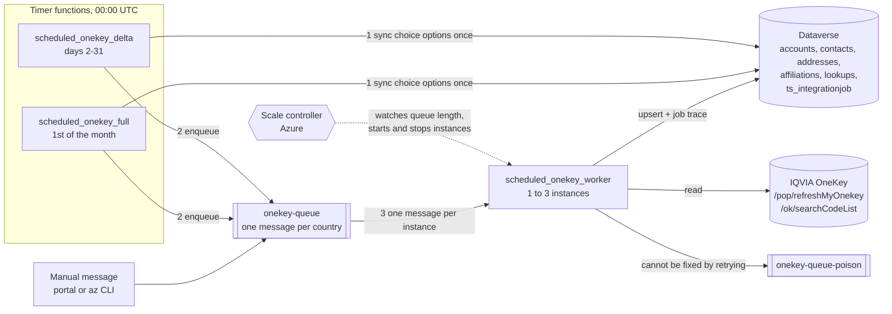
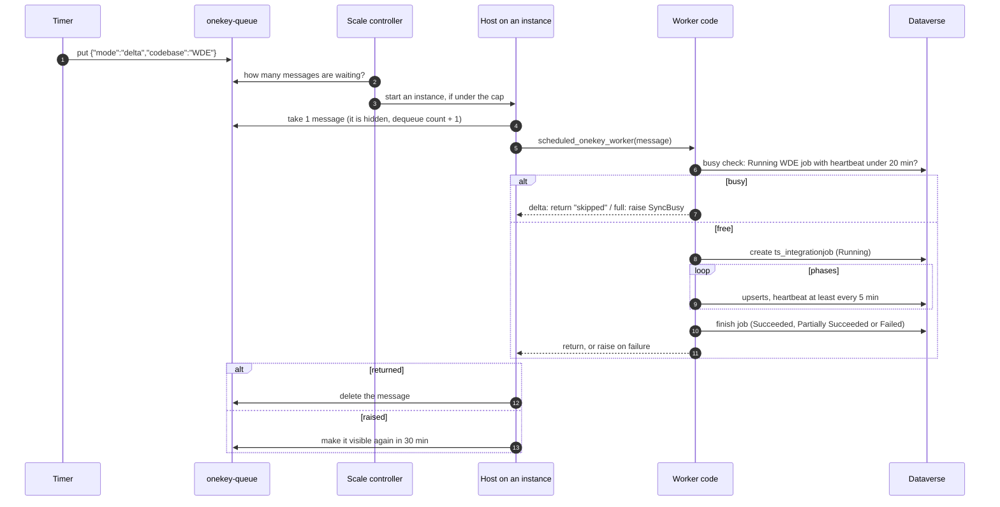
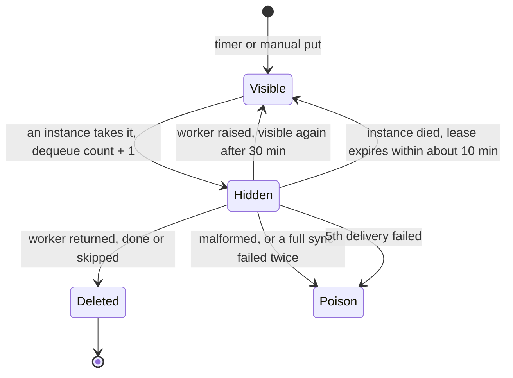
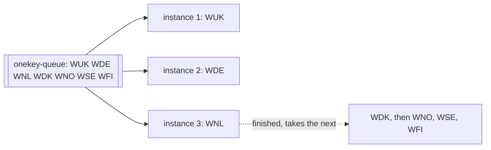

# Queue, worker and instance architecture

How the scheduled OneKey → Dataverse sync runs in Azure: what a message is, who
picks it up, how many run at once, and what stops two runs from colliding.
Setup and app settings are in [AZURE_FUNCTION_SETUP.md](AZURE_FUNCTION_SETUP.md);
the code packages are in [architecture.md](architecture.md).

## Overview



The timers decide **what** to sync and finish in seconds. The worker does the
sync, one country per message, for seconds (delta) to hours (full).

## Components

| Component | What it is | Where |
| --- | --- | --- |
| Timer functions | `scheduled_onekey_delta` (00:00 UTC, days 2-31) and `scheduled_onekey_full` (00:00 UTC, the 1st). Each syncs the choice options once, then puts one message per country in `ONEKEY_CODBASE` on the queue. Idle unless `SYNC_SCHEDULE` is true. | `function_app.py` |
| `onekey-queue` | Azure Storage queue in the app's storage account. A to-do list of countries to sync. | `AzureWebJobsStorage` |
| Message | Small JSON, Base64-encoded on the queue: `{"mode":"delta","codebase":"WDE","choices":false,…}`. Azure adds an id, insertion time and a **dequeue count**. | `integration/queue_sync.py` (`SyncQueueMessage`) |
| `onekey-queue-poison` | Messages that will not be retried any more. Nothing reads it; a person resends or deletes them. | same account |
| Worker | `scheduled_onekey_worker`, the Python function that runs one message. | `function_app.py`, `integration/queue_sync.py` (`handle_message`, `dispatch`) |
| Instance | A machine Azure starts on demand (2 GB, 1 vCPU) running the Functions host and this code. Runs **one message at a time**. | Flex Consumption plan |
| Host | The Functions runtime on each instance. Fetches a message, calls the worker, then deletes or returns the message. | Azure |
| Scale controller | Azure component outside the app. Counts waiting messages and decides how many worker instances to run, up to the cap. | Azure |
| Sync engine | Runs the phases for one country and writes the job trace. | `integration/scheduled_sync.py`, `integration/dynamic_sync.py` |

## Life of a message



While the worker runs, the host keeps the message hidden (it renews the lease
every few minutes), so no other instance can take it, however long the sync
takes.

### Message states



| Outcome | Who decides | What happens |
| --- | --- | --- |
| Sync succeeded, or delta skipped as busy | worker returns | Host deletes the message |
| Delta failed | worker raises | Visible again after `visibilityTimeout` (30 min); poison after `maxDequeueCount` (5) deliveries |
| Full sync failed | worker | Retried once; on the 2nd failed delivery the worker writes it to the poison queue itself (`FULL_MAX_DELIVERIES`), because each retry repeats hours of work |
| Full sync, country busy | worker raises `SyncBusy` | Visible again after 30 min; counts as a delivery |
| Malformed message | worker | Straight to the poison queue; retrying cannot fix it |
| Instance killed mid-run (restart, deployment, scale-in, 12 h timeout) | nobody | Lease expires, message reappears, another instance runs it from the first phase |

## Instances and scaling

Flex Consumption scales **per function**: the worker gets its own instances,
separate from each timer. The scale controller wants one instance per waiting
message, because each instance takes one message at a time (`batchSize: 1`,
`newBatchThreshold: 0`).

**Maximum instance count** is the ceiling on that number. It is a limit, not
what is running: with nothing on the queue there are zero instances and no cost.



| Messages waiting | Cap 100 (Azure default) | Cap 3 (this project) |
| --- | --- | --- |
| 0 | 0 instances | 0 instances |
| 1 | 1 | 1 |
| 7 (all countries) | 7 at once | 3 at once, 4 wait in the queue |

**Why 3:** every instance writes to Dataverse as the same application user, which
is limited to 6,000 requests and 20 minutes of execution per 5 minutes, and 52
requests at a time. Beyond two or three workers you get throttling (429) waits,
not speed, and every country hits OneKey at the same moment. Waiting messages
lose nothing: a delta reads from where the previous one stopped, not from when
it was enqueued.

Set or check the cap:

```bash
az functionapp scale config set -g RG-ONEKEY-D365-TEST -n FUNC-ONEKEY-D365-TEST \
  --maximum-instance-count 3
az functionapp show -g RG-ONEKEY-D365-TEST -n FUNC-ONEKEY-D365-TEST \
  --query "properties.functionAppConfig.scaleAndConcurrency.maximumInstanceCount"
```

Portal: Function App → **Settings → Scale and concurrency** → **Maximum
instance count** → 3 → **Save**. The cap applies to each function separately;
the timers only ever need one instance.

### What an instance does

| Stage | Detail |
| --- | --- |
| Start | Boots, loads Python, `function_app.py` and `config/*.csv` in a few seconds (logs `Host started`) |
| Poll | Asks the queue for a message: quickly while messages arrive, backing off to every 30 s when it is empty (`maxPollingInterval`) |
| Run | One message at a time; its own memory and its own OneKey and Dataverse connections |
| Reuse | When a sync ends, the same instance takes the next waiting message while it is warm |
| Stop | Removed when the queue is empty and nothing runs. A sync still running gets up to 60 min on scale-in and 10 min on a platform update |
| Cost | Pay per GB-second while a sync runs, plus a small per-execution charge. Idle instances cost nothing (no always-ready instances) |
| Logs | Application Insights, tagged with the instance name (`cloud_RoleInstance`) |

## Keeping runs apart

| Case | Protection |
| --- | --- |
| Same message | Hidden while one instance runs it |
| Different countries | Nothing shared: accounts and contacts are keyed by OneKey ID, which carries the country (`WUKE…`, `WDEH…`); lookup rows by `{codBase}.{list}.{code}`; each worker retries only its own country's failures; choice options are synced once by the timer before enqueueing |
| Same country twice (duplicate message, manual plus scheduled, a full still running at the next delta) | **Busy check** before the run: a Running job of that country with a heartbeat under 20 min old means a delta is skipped and a full sync is deferred |
| Remaining gap | Two messages for one country starting within about a second can both pass the check. The timer removes duplicate codes, and upserts on `ts_externalid` keep records from duplicating. The CLI (`scripts/run_scheduled_sync.py`) does not run the busy check |

### Heartbeat

`ts_integrationjob.ts_lastheartbeat` is the last time a running sync proved it
was alive. A killed sync never reaches the end, so its status stays `Running`;
only the heartbeat age tells a live job from a dead one.

| Writer | When |
| --- | --- |
| Job start | Row created with heartbeat = start time |
| After every OneKey or Dataverse request, and before each OneKey retry wait | `JobTracer.beat()` writes only if 5 min have passed since the last write |
| End of each phase | Written with the progress counts |

| Reader | Rule |
| --- | --- |
| Busy check | Running and heartbeat under 20 min (4 missed beats): alive |
| Retry step | Running and heartbeat over 1 hour: dead, its failures may be retried |

A killed job therefore blocks its country for at most 20 minutes, and its row
needs no clean-up.

## What the worker runs

| `mode` | Steps |
| --- | --- |
| `delta` | Retry this country's pending failures → read OneKey changes in the window → phases → resolve pending failures it fixed |
| `full` | Read the whole population → phases → resolve pending failures it fixed |

Phases, in order: lookup tables for the country, HCO accounts, addresses,
parent hierarchy, HCO–HCO affiliations, HCP contacts, HCP–HCO affiliations.

**Delta window start**, first match wins:

1. `--date-from` on the CLI
2. App setting `SYNC_DELTA_FROM`
3. Where the last Full or Delta job of the country that covered its window
   stopped reading (the earlier of `ts_watermarkto` and `ts_startedon`), less
   15 minutes
4. No such job: a **full sync** runs instead (logged as `mode=delta ran=full`)

The window ends when the worker runs, after the retry step.

## Configuration

| Setting | Value | Effect |
| --- | --- | --- |
| `host.json` `functionTimeout` | `12:00:00` | Longest single run |
| `host.json` `queues.batchSize` / `newBatchThreshold` | 1 / 0 | One message per instance |
| `host.json` `queues.visibilityTimeout` | 30 min | Delay before a **failed** message is retried. Not a run limit |
| `host.json` `queues.maxDequeueCount` | 5 | Deliveries before the host poisons a message |
| `host.json` `queues.maxPollingInterval` | 30 s | Longest wait before a new message is noticed |
| Maximum instance count | 3 | Countries running at once |
| `ONEKEY_CODBASE` | `WUK,WDE,WNL,WDK,WNO,WSE,WFI` | Countries the timers enqueue |
| `SYNC_SCHEDULE` | `true` | Timers enqueue; `false` stops them |
| `SYNC_DELTA_FROM` | unset | Fixed delta start for every country while set |
| `SYNC_SKIP_UNCHANGED` | `true` | Records that already hold their values are not written |

Changing an app setting restarts the app, which stops any sync that is running.

## Operating it

```bash
RG=RG-ONEKEY-D365-TEST; ACCOUNT=rgonekeyd365testae59

# run one country now
az storage message put -q onekey-queue --account-name $ACCOUNT --auth-mode key -o none \
  --content "$(printf '%s' '{"mode":"full","codebase":"WDE"}' | base64)"

# see waiting and given-up messages (running ones are hidden)
az storage message peek -q onekey-queue        --account-name $ACCOUNT --auth-mode key --num-messages 32
az storage message peek -q onekey-queue-poison --account-name $ACCOUNT --auth-mode key --num-messages 32

# stop: no new work, then empty the queues
az functionapp config appsettings set -g $RG -n FUNC-ONEKEY-D365-TEST --settings SYNC_SCHEDULE=false
az storage message clear -q onekey-queue        --account-name $ACCOUNT --auth-mode key
az storage message clear -q onekey-queue-poison --account-name $ACCOUNT --auth-mode key
```

Application Insights, one line per stage of each message:

```kusto
traces
| where timestamp > ago(1d)
| where message has_any ("scheduled_queue", "Queue work started", "Integration job", "Delta window", "Delta starts at")
| project timestamp, cloud_RoleInstance, operation_Id, message
| order by timestamp desc
```

## Known limits

- A retried run starts again from the first phase; there is no phase resume.
- Records that leave the OneKey population are not deactivated in Dataverse.
- Log sampling is on in `host.json`; some worker trace lines can be missing.
  Add `Trace` to `excludedTypes` to keep all of them.
- Settings changes reach running instances only after they restart, so wait a
  couple of minutes before triggering a run.
