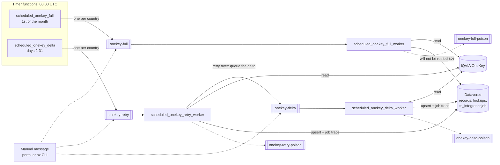
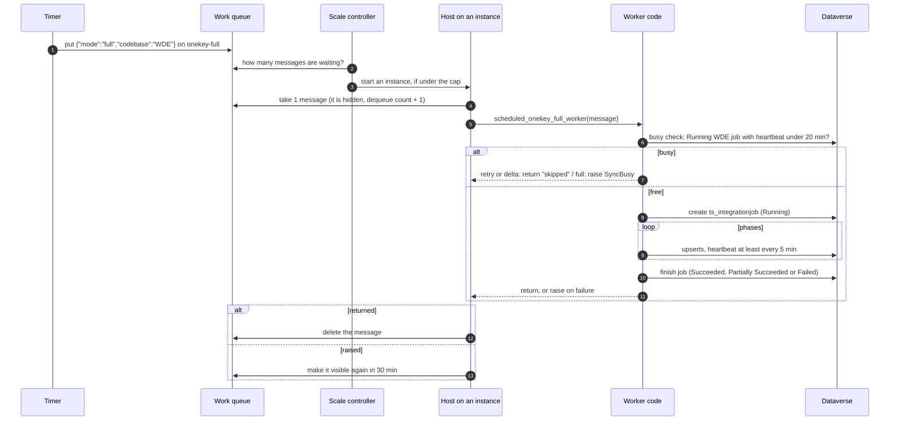
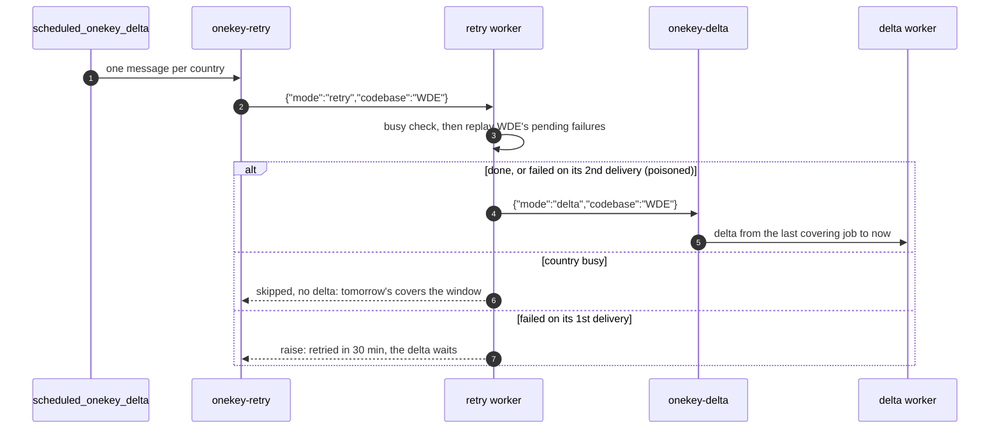
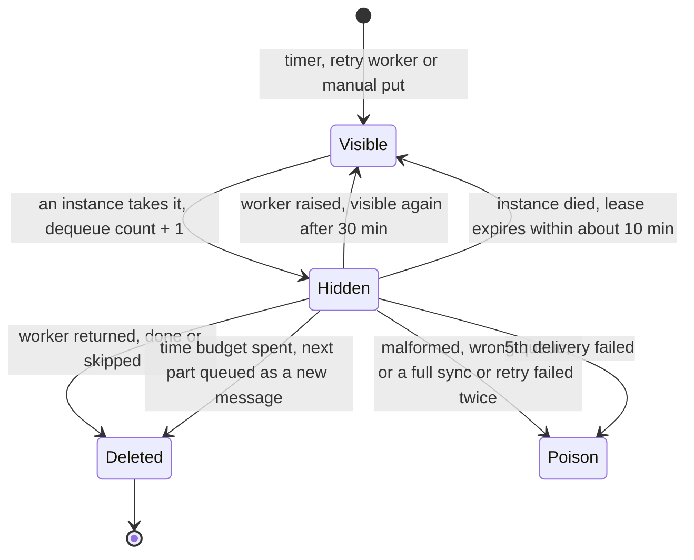

# Queue, worker and instance architecture

How the scheduled OneKey → Dataverse sync runs in Azure: what a message is, who
picks it up, how many run at once, and what stops two runs from colliding.
Setup and app settings are in [AZURE_FUNCTION_SETUP.md](AZURE_FUNCTION_SETUP.md);
the code packages are in [architecture.md](architecture.md).

## Overview



The timers decide **what** to sync and finish in seconds; each also syncs the
choice options once before it enqueues. Each kind of work has its own queue
and worker, one country per message: a full sync (minutes to hours), a retry
of the country's pending failures, then its delta (seconds to minutes).

## Components

| Component | What it is | Where |
| --- | --- | --- |
| Timer functions | `scheduled_onekey_full` (00:00 UTC, the 1st) puts one message per country in `ONEKEY_CODBASE` on `onekey-full`; `scheduled_onekey_delta` (00:00 UTC, days 2-31) puts one on `onekey-retry`. Each syncs the choice options once first. Idle unless `SYNC_SCHEDULE` is true. | `function_app.py` |
| Queues | `onekey-full`, `onekey-retry`, `onekey-delta`: Azure Storage queues in the app's storage account, each a to-do list of countries for one kind of work. `onekey-delta` is filled by the retry worker. | `AzureWebJobsStorage`, `integration/queue_sync.py` (`QUEUES`) |
| Message | Small JSON, Base64-encoded on the queue: `{"mode":"retry","codebase":"WDE","choices":false,…}`. `mode` may be left out; the queue supplies it. A message whose `mode` belongs to another queue is poisoned. Azure adds an id, insertion time and a **dequeue count**. | `integration/queue_sync.py` (`SyncQueueMessage`) |
| Poison queues | `onekey-full-poison`, `onekey-retry-poison`, `onekey-delta-poison`: messages that will not be retried any more. Azure names them `<queue>-poison` and the workers write to the same ones. Nothing reads them; a person resends or deletes them. | same account |
| Workers | `scheduled_onekey_full_worker`, `scheduled_onekey_retry_worker`, `scheduled_onekey_delta_worker`: one Python function per queue, each running one message. | `function_app.py`, `integration/queue_sync.py` (`handle_message`, `dispatch`) |
| Instance | A machine Azure starts on demand (2 GB, 1 vCPU) running the Functions host and this code. Runs **one message at a time**. | Flex Consumption plan |
| Host | The Functions runtime on each instance. Fetches a message, calls the worker, then deletes or returns the message. | Azure |
| Scale controller | Azure component outside the app. Counts waiting messages and decides how many worker instances to run, up to the cap. | Azure |
| Sync engine | Runs the phases for one country and writes the job trace. | `integration/scheduled_sync.py`, `integration/dynamic_sync.py` |

## Life of a message



While the worker runs, the host keeps the message hidden (it renews the lease
every few minutes), so no other instance can take it, however long the sync
takes.

### Daily chain: retry, then delta

The delta timer only fills `onekey-retry`. The retry worker queues the
country's delta when its retry is over, so the two never run at the same time:
the busy check counts a running retry, and a delta started beside it would be
skipped.



### Message states



| Outcome | Who decides | What happens |
| --- | --- | --- |
| Work succeeded, or a retry or delta skipped as busy | worker returns | Host deletes the message. A finished retry also queues the delta; a skipped one does not |
| Delta failed | worker raises | Visible again after `visibilityTimeout` (30 min); poison after `maxDequeueCount` (5) deliveries |
| Retry failed | worker | Retried once, while the delta waits; on the 2nd failed delivery the worker writes it to `onekey-retry-poison` itself (`RETRY_MAX_DELIVERIES`) and queues the delta anyway. Its rows stay Pending for the next run |
| Full sync failed | worker | Retried once; on the 2nd failed delivery the worker writes it to `onekey-full-poison` itself (`FULL_MAX_DELIVERIES`), because each retry repeats hours of work |
| Full sync, country busy | worker raises `SyncBusy` | Visible again after 30 min; counts as a delivery |
| Full sync or delta still running after `SYNC_TIME_BUDGET_MINUTES` | worker | Stops between batches, finishes its job as not covering its window, and queues part N+1 on its own queue; the message is deleted. See [Time budget and continuations](#time-budget-and-continuations) |
| Malformed message, or a `mode` for another queue | worker | Straight to the poison queue; retrying cannot fix it |
| Instance killed mid-run (restart, deployment, scale-in, 12 h timeout) | nobody | Lease expires, message reappears, another instance runs it from the first phase |

`maxDequeueCount` and `visibilityTimeout` in `host.json` apply to all three
queues; the per-queue limits above live in `integration/queue_sync.py`.

### Time budget and continuations

Flex Consumption ends a running execution 60 minutes into a scale-in, and a
large country's first load writes for hours. So a full sync or delta from the
queue stops itself after `SYNC_TIME_BUDGET_MINUTES` (default 45), always
between two batches, leaving time to finish the batch and the job record:

1. The job ends Partially Succeeded with `<country>: paused, time budget spent
   before a <phase> batch` in `ts_errorsummary`, so it does not cover its window.
2. The worker queues the same message with `"part": N+1` on its own queue
   (`scheduled_queue_continued` in the log). It keeps the run's `run_id`, so
   the run's total time covers every part.
3. The next part reads OneKey again and goes through the phases again. With
   `SYNC_SKIP_UNCHANGED` on, what earlier parts wrote is only read and
   compared, so it gets past them in minutes and writes the rest.

A part is poisoned instead of continued when it wrote nothing (the OneKey walk
alone outlasted the budget), when `SYNC_SKIP_UNCHANGED` is off (every part
would rewrite the same records), or after `MAX_PARTS` (12) parts. A
steady-state monthly full sync, which mostly skips, should finish in one part.

## Instances and scaling

Flex Consumption scales **per function**: each of the three workers gets its
own instances, separate from each other and from the timers. The scale
controller wants one instance per waiting message on that worker's queue,
because each instance takes one message at a time (`batchSize: 1`,
`newBatchThreshold: 0`).

**Maximum instance count** is the ceiling on that number, for **each** worker.
It is a limit, not what is running: with nothing on the queues there are zero
instances and no cost.


| Messages waiting on one queue | Cap 100 (Azure default) | Cap 3 (this project) |
| --- | --- | --- |
| 0 | 0 instances | 0 instances |
| 1 | 1 | 1 |
| 7 (all countries) | 7 at once | 3 at once, 4 wait in the queue |

With a cap of 3, up to 9 instances can run when all three queues have work:
3 full syncs, 3 retries and 3 deltas. In practice the full syncs run on the
1st, when no delta is scheduled, and a country's retry and delta run one after
the other. Retries and deltas only overlap a full sync that is still running
on the 2nd, and then only for the countries that full sync has finished.

**Why 3:** every instance writes to Dataverse as the same application user, which
is limited to 6,000 requests and 20 minutes of execution per 5 minutes, and 52
requests at a time. Beyond two or three workers you get throttling (429) waits,
not speed, and every country hits OneKey at the same moment. Lower the cap to 2
if retries and deltas overlapping a long full sync start to throttle. Waiting
messages lose nothing: a delta reads from where the previous one stopped, not
from when it was enqueued.

Set or check the cap:

```bash
az functionapp scale config set -g RG-ONEKEY-D365-TEST -n FUNC-ONEKEY-D365-TEST \
  --maximum-instance-count 3
az functionapp show -g RG-ONEKEY-D365-TEST -n FUNC-ONEKEY-D365-TEST \
  --query "properties.functionAppConfig.scaleAndConcurrency.maximumInstanceCount"
```

Portal: Function App → **Settings → Scale and concurrency** → **Maximum
instance count** → 3 → **Save**. The cap applies to each function separately,
so to each worker; the timers only ever need one instance.

### What an instance does

| Stage | Detail |
| --- | --- |
| Start | Boots, loads Python, `function_app.py` and `config/*.csv` in a few seconds (logs `Host started`) |
| Poll | Asks the queue for a message: quickly while messages arrive, backing off to every 30 s when it is empty (`maxPollingInterval`) |
| Run | One message at a time; its own memory and its own OneKey and Dataverse connections |
| Reuse | When a sync ends, the same instance takes the next waiting message while it is warm |
| Stop | Removed when the queue is empty and nothing runs. A sync still running gets up to 60 min on scale-in and 10 min on a platform update |
| Cost | Pay per GB-second while a sync runs, plus a small per-execution charge. Idle instances cost nothing (no always-ready instances) |
| Logs | Application Insights, tagged with the instance name (`cloud_RoleInstance`) |

## Keeping runs apart

| Case | Protection |
| --- | --- |
| Same message | Hidden while one instance runs it |
| Different countries | Nothing shared: accounts and contacts are keyed by OneKey ID, which carries the country (`WUKE…`, `WDEH…`); lookup rows by `{codBase}.{list}.{code}`; each retry replays only its own country's failures; choice options are synced once by the timer before enqueueing |
| Retry and delta of one country | Chained, never queued together: the retry worker queues the delta when the retry is over |
| Same country twice (duplicate message, manual plus scheduled, a full still running at the next delta) | **Busy check** before the run: a Running job of that country with a heartbeat under 20 min old means a retry or delta is skipped and a full sync is deferred. Retry jobs of the message's own run do not count: a country's retry ends before its delta is queued, so such a job was left by a killed delivery. A killed delta or full sync still blocks its own redelivery, since one stopped by the 60-minute scale-in limit would only be stopped again |
| Remaining gap | Two messages for one country starting within about a second can both pass the check. The timer removes duplicate codes, and upserts on `ts_externalid` keep records from duplicating. The CLI (`scripts/run_scheduled_sync.py`) does not run the busy check |

### Heartbeat

`ts_integrationjob.ts_lastheartbeat` is the last time a running sync proved it
was alive. A killed sync never reaches the end, so its status stays `Running`;
only the heartbeat age tells a live job from a dead one.

| Writer | When |
| --- | --- |
| Job start | Row created with heartbeat = start time |
| After every OneKey or Dataverse request, and every minute of a OneKey retry wait | `JobTracer.beat()` writes only if 5 min have passed since the last write. It sends the write once, without retries, and tries again a minute later if it failed. Dataverse retry waits do not write it, since it would be throttled too; they are capped so a throttled request stays inside the 20 min |
| End of each phase | Written with the progress counts |

| Reader | Rule |
| --- | --- |
| Busy check | Running and heartbeat under 20 min (4 missed beats): alive |
| Retry step | Running and heartbeat over 1 hour: dead, its failures may be retried |

A killed job therefore blocks its country for at most 20 minutes; a killed
retry does not block its own run at all. Its row needs no clean-up.

## What the workers run

| Queue (`mode`) | Steps |
| --- | --- |
| `onekey-full` (`full`) | Read the whole population → phases → resolve pending failures it fixed |
| `onekey-retry` (`retry`) | Replay this country's pending failures (up to `retry_limit`, default 100) → queue the delta |
| `onekey-delta` (`delta`) | Read OneKey changes in the window → phases → resolve pending failures it fixed |

The CLI (`scripts/run_scheduled_sync.py`) still runs retry then delta in one
process.

Phases, in order: lookup tables for the country, HCO accounts, addresses,
parent hierarchy, HCO–HCO affiliations, HCP contacts, HCP–HCO affiliations.

**Delta window start**, first match wins:

1. `--date-from` on the CLI
2. App setting `SYNC_DELTA_FROM`
3. Where the last Full or Delta job of the country that covered its window
   stopped reading (the earlier of `ts_watermarkto` and `ts_startedon`), less
   6 hours (`WINDOW_OVERLAP`): OneKey dates a change before it can serve it,
   after a delay that is not constant
4. No such job: a **full sync** runs instead (logged as `mode=delta ran=full`)

The window ends when the delta worker runs, after the retry.

## Configuration

| Setting | Value | Effect |
| --- | --- | --- |
| `host.json` `functionTimeout` | `12:00:00` | Longest single run |
| `host.json` `queues.batchSize` / `newBatchThreshold` | 1 / 0 | One message per instance |
| `host.json` `queues.visibilityTimeout` | 30 min | Delay before a **failed** message is retried, on every queue. Not a run limit |
| `host.json` `queues.maxDequeueCount` | 5 | Deliveries before the host poisons a message, on every queue |
| `host.json` `queues.maxPollingInterval` | 30 s | Longest wait before a new message is noticed |
| `FULL_MAX_DELIVERIES` / `RETRY_MAX_DELIVERIES` | 2 / 2 | Deliveries before the worker poisons a failed full sync / retry (`integration/queue_sync.py`) |
| Maximum instance count | 3 | Countries running at once, per worker |
| `ONEKEY_CODBASE` | `WUK,WDE,WNL,WDK,WNO,WSE,WFI` | Countries the timers enqueue |
| `SYNC_SCHEDULE` | `true` | Timers enqueue; `false` stops them |
| `SYNC_DELTA_FROM` | unset | Fixed delta start for every country while set |
| `SYNC_SKIP_UNCHANGED` | `true` | Records that already hold their values are not written. Needed for continuations |
| `SYNC_TIME_BUDGET_MINUTES` | `45` | A queued full sync or delta stops between batches after this long and queues its next part; `0` turns it off |
| `ONEKEY_PACKET_DELAY` | `2.5` | Seconds between OneKey packets; keeps three parallel walks under OneKey's ~50 calls a minute |

Changing an app setting restarts the app, which stops any sync that is running.

## Operating it

```bash
RG=RG-ONEKEY-D365-TEST; ACCOUNT=rgonekeyd365testae59

# run one country now: a full sync, or retry then delta, or the delta alone
put() { az storage message put -q "$1" --account-name $ACCOUNT --auth-mode key -o none \
  --content "$(printf '%s' "$2" | base64)"; }
put onekey-full  '{"codebase":"WDE"}'
put onekey-retry '{"codebase":"WDE"}'
put onekey-delta '{"codebase":"WDE"}'

# see waiting and given-up messages (running ones are hidden)
for q in onekey-full onekey-retry onekey-delta; do
  for name in $q $q-poison; do
    echo "== $name"
    az storage message peek -q $name --account-name $ACCOUNT --auth-mode key --num-messages 32
  done
done

# stop: no new work, then empty the queues
az functionapp config appsettings set -g $RG -n FUNC-ONEKEY-D365-TEST --settings SYNC_SCHEDULE=false
for q in onekey-full onekey-retry onekey-delta; do
  az storage message clear -q $q        --account-name $ACCOUNT --auth-mode key
  az storage message clear -q $q-poison --account-name $ACCOUNT --auth-mode key
done
```

Application Insights, one line per stage of each message. Every worker line
carries `queue=`; `scheduled_queue_chained` marks a retry queuing its delta:

```kusto
traces
| where timestamp > ago(1d)
| where message has_any ("scheduled_queue", "Queue work started", "Integration job", "Delta window", "Delta starts at")
| project timestamp, cloud_RoleInstance, operation_Id, message
| order by timestamp desc
```

### How long a run took

Each timer run gets a `run_id` such as `delta-20261012T000001Z-7`: the kind
of run, when the timer queued it, and how many countries it queued. Its
messages carry the id and the queue time, and a retry passes both on to its
delta, so the daily run covers each country's retry and delta. Every job the
run starts has `run=<run_id>` at the end of its `ts_integrationjob` name.
Manual messages have no run.

- **Total time**: from when the timer queued the run until its last job
  ended, once every country is done. This is the number to compare when
  changing the instance cap.
- **Work time**: all the run's job times added up, roughly what it would take
  on one instance.

From Dataverse, the reliable record:

```bash
python scripts/sync_run_report.py               # newest run
python scripts/sync_run_report.py --last full   # newest monthly full sync
python scripts/sync_run_report.py --run delta-20261012T000001Z-7
```

It prints how many countries are finished out of the run's count, the total
and work time, then each job's type, state, start, end and duration. Retry
jobs show as `Retry`. A country is finished when its full or delta job
covered its whole window; a failed job does not count, because Azure retries
its message. Until every country is finished the total is the time so far,
including countries still waiting in a queue or for a retry. A job killed
while Running counts as Stopped, ending at its last heartbeat. A country
skipped as busy, or whose message went to a poison queue, never finishes the
run; check the `scheduled_queue_skipped` / `scheduled_queue_poisoned` lines
for it.

From Application Insights, each finished message logs
`scheduled_run_progress run=… duration_s=… elapsed_s=…`, where `elapsed_s` is
the run's time so far. A run's largest `elapsed_s` is its total. Log sampling
can drop lines, so prefer the script for exact numbers:

```kusto
traces
| where message startswith "scheduled_run_progress"
| extend run = extract(@"run=(\S+)", 1, message),
         codebase = extract(@"codebase=(\w+)", 1, message),
         duration_s = toint(extract(@"duration_s=(\d+)", 1, message)),
         elapsed_s = toint(extract(@"elapsed_s=(\d+)", 1, message))
| summarize total_min = round(max(elapsed_s) / 60.0, 1),
            work_min = round(sum(duration_s) / 60.0, 1),
            countries = dcount(codebase), messages = count() by run
| order by run desc
```

### Delta contact changes not applied

A delta writes a contact only when the individual, its main activity and the
workplace all came in its window. Each delta job records the rest in
`ts_phasecounts` as `"unjoined":{"activities":…,"individuals":…}` and logs a
warning. Watch it for a couple of weeks before deciding whether those changes
need replaying (they otherwise wait for the next monthly full sync):

```kusto
traces
| where timestamp > ago(14d)
| where message startswith "Delta changes not applied to contacts"
| extend codebase = extract(@"codbase=(\w+)", 1, message),
         activities = toint(extract(@"activities_without_individual_or_workplace=(\d+)", 1, message)),
         individuals = toint(extract(@"individuals_without_activity=(\d+)", 1, message))
| summarize deltas = count(), activities = sum(activities), individuals = sum(individuals) by codebase
```

### Moving from `onekey-queue`

Before this layout, one worker read `onekey-queue`. Nothing reads it now. Before
deploying, set `SYNC_SCHEDULE=false`, let `onekey-queue` empty or clear it, then
deploy and set `SYNC_SCHEDULE=true` again. Resend anything still wanted from
`onekey-queue-poison` to its new queue, then delete both old queues. The
bindings create the new queues on first use.

## Known limits

- A part, or a run retried after a failure, starts again from the OneKey walk
  and the first phase; skip-unchanged makes the repeated phases cheap, but the
  walk (about 15 minutes for WDE) is read again each time.
- A retry whose instance is killed on every delivery is poisoned by Azure
  without running the worker, so it queues no delta. The next day's delta
  starts from the last covering job, so no window is lost.
- Records that leave the OneKey population are not deactivated in Dataverse.
- Log sampling is on in `host.json`; some worker trace lines can be missing.
  Add `Trace` to `excludedTypes` to keep all of them.
- Settings changes reach running instances only after they restart, so wait a
  couple of minutes before triggering a run.
- Message fields a version does not know are logged and ignored from this
  version on, so rolling back keeps newer messages. Versions before the run
  fields (`run_id`, `enqueued_at`) reject them and poison the message: drain
  the queues before rolling back that far.
